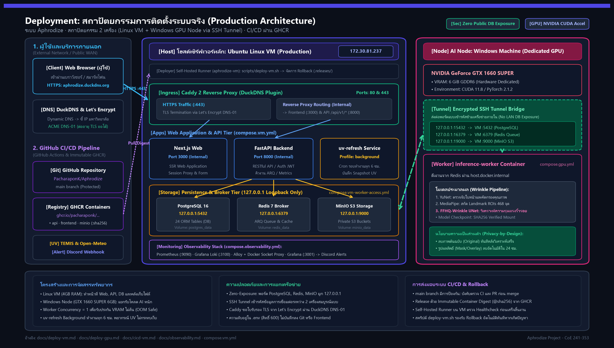
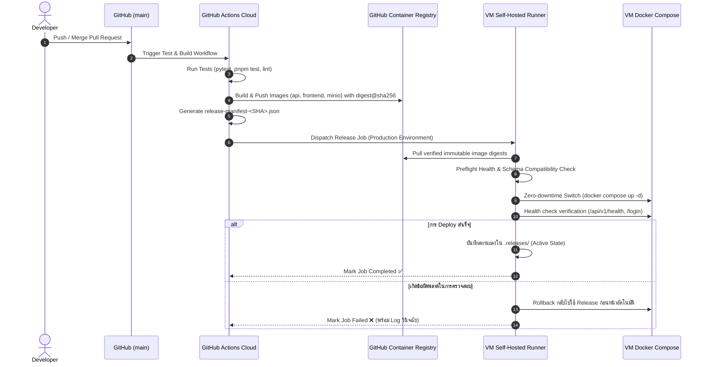

# แผนภาพสถาปัตยกรรมการติดตั้งระบบ (Deployment Diagram)

เอกสารนี้แสดงสถาปัตยกรรมการติดตั้งระบบจริง (Production Deployment Architecture) ของโครงการ **Aphrodize** ตามการตั้งค่า Docker Compose, เครือข่าย, ความปลอดภัย และระบบ CI/CD ล่าสุด

---

## 1. แผนภาพภาพรวมการติดตั้งระบบ (Deployment Architecture Diagram)



### Mermaid Flowchart:

```mermaid
flowchart TB
    %% External Actors & Services
    subgraph WAN [" เครือข่ายภายนอก / ผู้ใช้งานและบริการภายนอก "]
        User["💻 ไคลเอนต์ / เว็บบราวเซอร์<br/>(ผู้ใช้งานทั่วไป / แอดมิน)"]
        DuckDNS["🌐 DuckDNS & Let's Encrypt<br/>(Dynamic DNS & ACME DNS-01)"]
        ExtAPI["☀️ Open-Meteo & TEMIS<br/>(ข้อมูลสภาพอากาศและโอโซน UV)"]
        Discord["📢 Discord Channel<br/>(Grafana Alert Webhook)"]
    end

    %% GitHub CI/CD Ecosystem
    subgraph CICD [" GitHub Ecosystem (CI/CD Pipeline) "]
        Repo["📦 GitHub Repository<br/>(PacharaponK/Aphrodize)<br/>main branch (protected)"]
        GHA["⚙️ GitHub Actions Runners<br/>(Lint, Test, Docker Build)"]
        GHCR["🏷️ GitHub Container Registry (GHCR)<br/>ghcr.io/pacharaponk/...<br/>• aphrodize-api:sha256<br/>• aphrodize-frontend:sha256<br/>• aphrodize-minio:sha256"]
        Manifest["📄 Release Manifest<br/>(release-manifest-SHA.json)"]
    end

    %% Production Linux VM
    subgraph VM [" โฮสต์เซิร์ฟเวอร์โปรดักชัน: Linux VM (IP: 172.30.81.237) "]
        Runner["🤖 Self-Hosted Runner<br/>(aphrodize-vm / aphrodize-deploy)<br/>scripts/deploy-vm.sh"]
        ReleasesDir["📁 .releases/<br/>(Private Rollback & History)"]

        subgraph Ingress [" Ingress & Reverse Proxy Layer "]
            Caddy["🛡️ Caddy 2 Reverse Proxy<br/>(aphrodize-caddy:duckdns)<br/>• Port 80 (HTTP 301 Redirect)<br/>• Port 443 (HTTPS TLS Termination)"]
        end

        subgraph AppTier [" Application Layer (compose.vm.yml) "]
            Frontend["🖥️ Next.js Frontend<br/>(aphrodize-frontend:vm)<br/>Port 3000 (Internal)"]
            API["⚡ FastAPI Backend<br/>(aphrodize-api:vm)<br/>Port 8000 (Internal)"]
            UVWorker["🔄 uv-refresh Service<br/>(Profile: background)<br/>รอบการทำงานทุก 6 ชม."]
        end

        subgraph StorageTier [" Data & Queue Tier (127.0.0.1 Loopback Only) "]
            direction TB
            PG[("🐘 PostgreSQL 16 Alpine<br/>Port 5432 (127.0.0.1)<br/>Volume: postgres_data")]
            Redis[("⚡ Redis 7 Alpine<br/>Port 6379 (127.0.0.1)<br/>Volume: redis_data<br/>(ARQ Broker & Cache)")]
            MinIO[("🪣 MinIO Object Storage<br/>Port 9000 / 9001 (127.0.0.1)<br/>Volume: minio_data")]
            MinIOInit["🔧 minio-init<br/>(One-shot Bucket Setup)"]
        end

        subgraph ObsTier [" Observability Tier (compose.observability.yml) "]
            Prometheus["📊 Prometheus v3.5<br/>Port 9090 (127.0.0.1)"]
            Loki["📜 Loki v3.5<br/>Port 3100 (127.0.0.1)"]
            Alloy["🔍 Alloy & Docker Socket Proxy<br/>(Log Collector)"]
            Grafana["📈 Grafana 12.1<br/>Port 3001 (127.0.0.1)"]
        end
    end

    %% GPU Worker Node (Windows Machine)
    subgraph GPUHost [" เครื่อง AI Inference เฉพาะ: Windows Machine (On-Premises / LAN) "]
        SSHTunnel["🔒 SSH Local Port Forwarding Tunnel<br/>ssh -L 15432:5432 -L 16379:6379 -L 19000:9000<br/>(เข้ารหัสข้อมูลผ่าน SSH)"]
        
        subgraph GPUWorkerContainer [" Docker Worker Container (compose.gpu.yml) "]
            Worker["🧠 inference-worker<br/>(aphrodize-inference:cuda118)<br/>PyTorch 2.1.2 + CUDA 11.8"]
            GPUHW["⚡ ฮาร์ดแวร์: NVIDIA GTX 1660 SUPER<br/>(VRAM 6 GiB, CUDA Compute)"]
            ModelWeight["💾 Local Model Checkpoint<br/>FFHQ-Wrinkle UNet (SHA256 verified)"]
        end
    end

    %% Connections & Protocols
    User -->|"HTTPS (Port 443)<br/>aphrodize.duckdns.org"| Caddy
    Caddy -->|"Proxy (Port 3000)"| Frontend
    Caddy -->|"Proxy /api/v1 (Port 8000)"| API
    Frontend -->|"Server-side Call (Port 8000)"| API

    Caddy -.->|"ACME DNS-01 Challenge"| DuckDNS
    UVWorker -.->|"REST API (ดาวน์โหลดพยากรณ์)"| ExtAPI

    %% CI/CD Flows
    Repo -->|"Push / Merge main"| GHA
    GHA -->|"Build & Push Images"| GHCR
    GHA -->|"Upload Manifest"| Manifest
    GHA -.->|"Dispatch Job"| Runner
    Runner -->|"Pulls Images by digest@sha256"| GHCR
    Runner -->|"Atomic Switch & Save State"| ReleasesDir
    Runner -->|"Update Containers"| AppTier

    %% Internal VM App Connections
    API --> PG
    API --> Redis
    API --> MinIO
    MinIOInit -.->|"เตรียม Bucket ตอนเริ่ม"| MinIO
    UVWorker -->|"อ่าน/เขียน UV Snapshot"| API

    %% Observability Connections
    Prometheus -.->|"Scrape /metrics"| API
    Prometheus -.->|"Scrape metrics"| Caddy
    Alloy -.->|"Collect Container Logs"| Loki
    Grafana -->|"Query Metrics & Logs"| Prometheus
    Grafana -->|"Query Logs"| Loki
    Grafana -->|"Webhook Alert"| Discord

    %% Hybrid GPU Worker Connections via SSH Tunnel
    Worker -->|"CUDA Driver Call"| GPUHW
    Worker -->|"Mount Model (Read-Only)"| ModelWeight
    Worker -->|"TCP host.docker.internal:15432"| SSHTunnel
    Worker -->|"TCP host.docker.internal:16379"| SSHTunnel
    Worker -->|"TCP host.docker.internal:19000"| SSHTunnel

    SSHTunnel <====" SSH Tunnel ข้ามเครื่องผ่านเครือข่ายภายใน "====> StorageTier

    %% Styling
    classDef wanNode fill:#e0f2fe,stroke:#0284c7,stroke-width:2px,color:#0f172a;
    classDef cicdNode fill:#f3e8ff,stroke:#7e22ce,stroke-width:2px,color:#0f172a;
    classDef appNode fill:#f0fdf4,stroke:#16a34a,stroke-width:2px,color:#0f172a;
    classDef dataNode fill:#fef3c7,stroke:#d97706,stroke-width:2px,color:#0f172a;
    classDef gpuNode fill:#fce7f3,stroke:#db2777,stroke-width:2px,color:#0f172a;
    classDef obsNode fill:#ede9fe,stroke:#6366f1,stroke-width:2px,color:#0f172a;

    class User,DuckDNS,ExtAPI,Discord wanNode;
    class Repo,GHA,GHCR,Manifest cicdNode;
    class Caddy,Frontend,API,UVWorker,Runner,ReleasesDir appNode;
    class PG,Redis,MinIO,MinIOInit dataNode;
    class SSHTunnel,Worker,GPUHW,ModelWeight gpuNode;
    class Prometheus,Loki,Alloy,Grafana obsNode;
```

---

## 2. ตารางสรุปองค์ประกอบการติดตั้งระบบ (Component Breakdown)

| โซน (Tier) | บริการ (Service) | ภาพต้นทาง (Image) | พอร์ต / โปรโตคอล | คำอธิบายและหน้าที่สำคัญ |
| :--- | :--- | :--- | :--- | :--- |
| **Ingress** | `caddy` | `aphrodize-caddy:duckdns` | 80/TCP, 443/TCP (HTTPS) | Reverse Proxy, Automatic TLS ผ่าน DuckDNS DNS-01 ACME |
| **Web Frontend** | `frontend` | `aphrodize-frontend:vm` | 3000/TCP (Internal) | Next.js 14 SSR, Session Proxy, Form & Client Interface |
| **Platform API** | `api` | `aphrodize-api:vm` | 8000/TCP (Internal) | FastAPI Backend, Data validation, คิวงาน ARQ, Auth |
| **Background** | `uv-refresh` | `aphrodize-api:vm` | N/A (Internal Loop) | Cron script ดึงข้อมูลโอโซน/UV ทุก 6 ชม. บันทึก snapshot |
| **Database** | `postgres` | `postgres:16-alpine` | 5432/TCP (127.0.0.1) | ฐานข้อมูลหลัก (Users, Consents, Analyses, Daily Health) |
| **Queue & Cache** | `redis` | `redis:7-alpine` | 6379/TCP (127.0.0.1) | Message Broker สำหรับ ARQ Worker และ Key-value Cache |
| **Object Store** | `minio` | `aphrodize-minio` | 9000/TCP, 9001/TCP (127.0.0.1) | จัดเก็บไฟล์ภาพส่วนตัว, มาสก์ และผลการวิเคราะห์แบบจำกัดสิทธิ์ |
| **Bucket Init** | `minio-init` | `aphrodize-api:vm` | N/A (One-shot) | สร้าง Private Bucket อัตโนมัติก่อนเริ่มระบบ |
| **AI Inference** | `inference-worker` | `aphrodize-inference:cuda118` | Host internal -> SSH Tunnel | รัน FFHQ-Wrinkle UNet โมเดลบน GPU แยกเครื่อง (Windows) |
| **Observability** | `prometheus` | `prom/prometheus:v3.5.0` | 9090/TCP (127.0.0.1) | Scrape metrics จาก API, Caddy, Node, Docker |
| **Observability** | `loki` | `grafana/loki:3.5.0` | 3100/TCP (127.0.0.1) | จัดเก็บ Log รวมศูนย์จากทุกคอนเทนเนอร์ |
| **Observability** | `alloy` / `proxy` | `grafana/alloy` | Internal Network | รวบรวม Log จาก Docker daemon ผ่าน socket proxy ส่งเข้า Loki |
| **Observability** | `grafana` | `grafana/grafana:12.1.0` | 3001/TCP (127.0.0.1) | หน้าแดชบอร์ดตรวจสอบระบบ และแจ้งเตือนผ่าน Discord Webhook |

---

## 3. สถาปัตยกรรมความปลอดภัยและการเชื่อมต่อ (Security & Network Flow)

1. **การจำกัดการเผยแพร่พอร์ต (Zero Public Exposure of Data Stores)**:
   - พอร์ต PostgreSQL (`5432`), Redis (`6379`), และ MinIO (`9000`) ถูกผูกไว้กับ `127.0.0.1` (Loopback IP) ของ VM เท่านั้น ไม่มีการเปิดพอร์ตออกสู่ภายนอกหรือเครือข่าย LAN
   - เปิดเฉพาะพอร์ต `80` (HTTP สำหรับ Redirect) และ `443` (HTTPS) ที่ Bind กับ `VM_BIND_IP`
2. **การเชื่อมต่อเครื่อง GPU แบบไฮบริดผ่าน SSH Tunnel**:
   - เครื่องประมวลผล AI (Windows Desktop พร้อมการ์ดจอ GTX 1660 SUPER) ทำงานแยกจาก VM เนื่องจากข้อจำกัดด้านทรัพยากรของ VM (RAM 4GB และไม่มี GPU)
   - การเชื่อมต่อทำผ่าน Secure SSH Tunnel (Local Port Forwarding):
     ```bash
     ssh -N -T -L 127.0.0.1:15432:127.0.0.1:5432 -L 127.0.0.1:16379:127.0.0.1:6379 -L 127.0.0.1:19000:127.0.0.1:9000 aphrodize@172.30.81.237
     ```
   - คอนเทนเนอร์ `inference-worker` บน Windows จะติดต่อกับฐานข้อมูลและ MinIO ผ่าน `host.docker.internal:[15432, 16379, 19000]` อย่างปลอดภัย
3. **การรักษาความปลอดภัยของข้อมูลรูปภาพส่วนตัว (Privacy-by-Design)**:
   - ภาพต้นฉบับจะถูกส่งเข้า MinIO Private Bucket และถูกลบทันทีหลังการวิเคราะห์เสร็จสิ้น (`finally: remove_original`)
   - ภาพผลลัพธ์ (Mask/Overlay) จะมีอายุขัยเพียง 24 ชั่วโมง และถูกลบอัตโนมัติด้วย ARQ Task (`expire_analysis_artifacts`)

---

## 4. วงจรการส่งมอบระบบ CI/CD (CI/CD Release & Rollback Flow)


